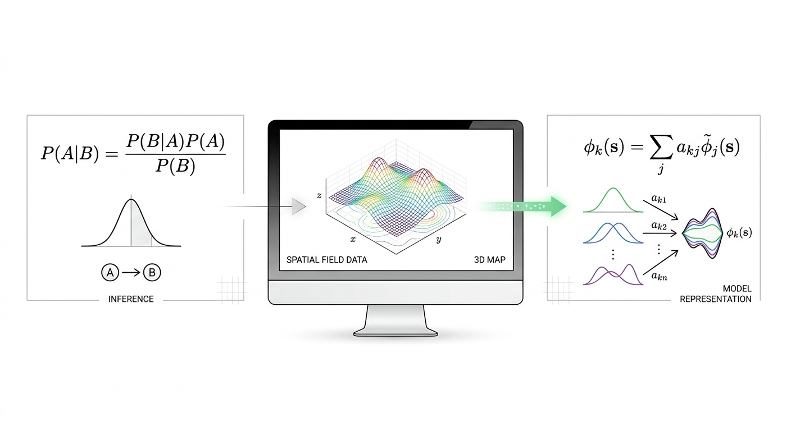
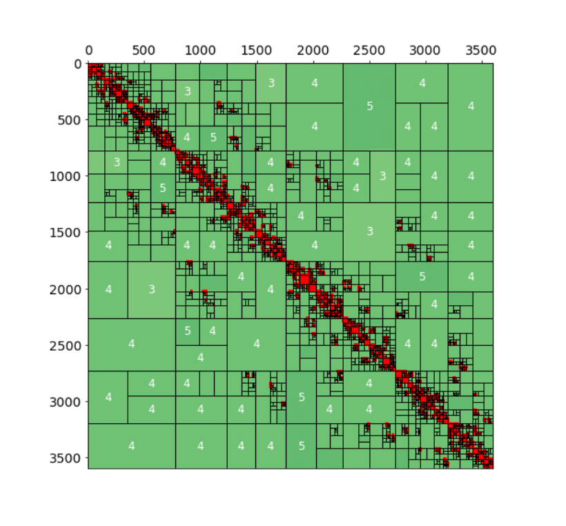
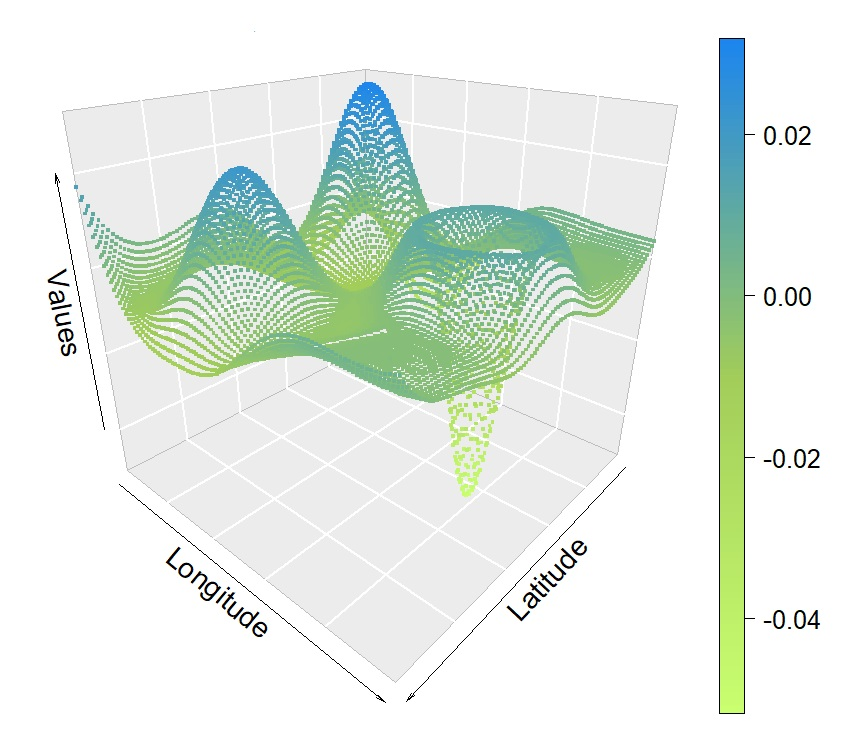

My research has been oriented on developing computational techniques for Bayesian spatial modeling, however now I am exploring its connections with Bayesian inverse problems, which is a central part of my current work. In parallel, I remain interested in numerical methods within a deterministic framework for spatial interpolation.

{width="80%" fig-align="center" style="margin-top: 30px; margin-bottom: 25px;"}

<!-- 
 -->
<!--    -->
<!-- 
 -->

(*The previous image was created by Gemini!!*)

# In Preparation

::: {style="text-align: justify;"}
- **Cavieres, J**., Hahn-Rigaud, B, 2026. Bayesian Image Reconstruction in Dynamic Inverse Problems: Scalable Spatio-Temporal Modelling via Implicit Priors for Sparse Acquisition Data.
:::

::: {style="text-align: justify;"}
- **Cavieres, J**., Krumscheid, S, 2026. Bayesian Spatio-Temporal Models via regTPS: Separable and Non-Separable Latent Fields using MCMC.
:::

::: {style="text-align: justify;"}
- Curé, M., Cassetti, J., Sarni, M., **Cavieres, J**, 2026. Decoding Stellar Rotation Regularised Inversion of Projected Rotational Velocities. 
:::

::: {style="text-align: justify;"}
- **Cavieres, J**., Monnahan, C.C., Bolin., D, 2025. Approximated Gaussian random field: effects of parameterization on MCMC sampling.
:::

::: {style="text-align:center; margin-top:50px;"}

:::

<h1>
  Publications/Preprints
</h1>

- **Cavieres, J.**, Krumscheid, S. (2026). regTPS: A Novel Approach To Approximate A Gaussian Random Field for Bayesian Spatial Modeling. <a href="https://link.springer.com/article/10.1007/s11222-026-10990-x" style="color: #0072B2; text-decoration: none;"><em>Statistics and Computing</em></a> | <a href="https://arxiv.org/abs/2510.04256" style="color: #8A2BE2; text-decoration: none;">arXiv preprint</a>

- **Cavieres, J.**, Moraga, P., Monnahan, C.C. (2024). Why not a thin plate spline for spatial models? A comparative study using Bayesian inference. <a href="https://arxiv.org/abs/2404.12756" style="color: #8A2BE2; text-decoration: none;">arXiv preprint</a>

- **Cavieres, J.**, Karkulik, M. (2022). Efficient estimation for a smoothing thin plate spline in a two-dimensional space. <a href="https://arxiv.org/abs/2404.01902" style="color: #8A2BE2; text-decoration: none;">arXiv preprint</a>

- **Cavieres, J.**, Monnahan, C.C., Bolin, D., and Bergherr, E. (2024). Approximated Gaussian Random Field Under Different Parameterizations for MCMC. <a href="https://doi.org/10.1007/978-3-031-65723-8_32" style="color: #0072B2; text-decoration: none;"><em>Developments in Statistical Modelling</em></a>

- Escárate, P., Curé, M., Araya, I., Coronel, M., Cedeño, A.L., Celedon, L., **Cavieres, J.**, et al. (2023). A method to deconvolve stellar profiles: The Non-Rotating Line utilizing Gaussian Sum Approximation. <a href="https://doi.org/10.1051/0004-6361/202346587" style="color: #0072B2; text-decoration: none;"><em>Astronomy & Astrophysics</em></a>

- Lu, M., **Cavieres, J.**, Moraga, P. (2023). A comparison of spatial and non-spatial machine learning methods in NO2 modelling: prediction accuracy, uncertainty quantification, and model interpretation. <a href="https://doi.org/10.1111/gean.12356" style="color: #0072B2; text-decoration: none;"><em>Geographical Analysis</em></a>

- **Cavieres, J.**, Ibacache-Pulgar, G., Contreras-Reyes, J.E. (2022). Thin plate spline model under skew-normal random errors: estimation and diagnostic analysis for spatial data. <a href="https://doi.org/10.1080/00949655.2022.2090564" style="color: #0072B2; text-decoration: none;"><em>Statistical Computation and Simulation</em></a>

- **Cavieres, J.**, Monnahan, C.C., Vehtari, A. (2021). Accounting for spatial dependence improves relative abundance estimates in a benthic marine species structured as a metapopulation. <a href="https://doi.org/10.1016/j.fishres.2021.105960" style="color: #0072B2; text-decoration: none;"><em>Fisheries Research</em></a>

- **Cavieres, J.**, Nicolis, O. (2018). Using a spatio-temporal Bayesian approach to estimate the relative abundance index of yellow squat lobster (<em>Cervimunida johni</em>) of Chile. <a href="https://doi.org/10.1016/j.fishres.2018.07.002" style="color: #0072B2; text-decoration: none;"><em>Fisheries Research</em></a>

::: {style="text-align:center; margin-top:50px;"}

:::

# Conferences & Workshops

- **Cavieres, J.**, Krumscheid, S., 2026. regTPS: A Novel Approach To Approximate A Gaussian Random Field for Bayesian Spatial Modeling. Statistical Computing 2026, Günzburg, Germany.

- **Cavieres, J**., Monnahan, C.C., Bolin, D., Bergherr, E., 2024. Approximated Gaussian random field under different parameterizations for MCMC. International Workshop on Statistical Modelling 2024, Durham, England.

- **Cavieres, J**., Moraga, P., Monnahan, C.C., 2023. Bayesian semiparametric spatial model using Template Model Builder ($\texttt{TMB}$). CFE-CMStatistics Conference 2023, Berlin, Germany.

- **Cavieres, J**., Monnahan, C.C., Moraga, P., 2023.A semiparametric thin plate spline spatial model using Bayesian computation. Statistical Computing 2023, Günzburg, Germany.

- Cure, M., Arcos, C., Araya, I., Escarate, P., Celedon, L., **Cavieres, J**., Pezoa, R., Olivares, E., Farias, G., 2022. Bayesian deconvolution of a rotating spectral line profile to a non-rotating one. XXXI General Assembly of international Astronomical Union, Busan, Republic of Korea.

- **Cavieres, J**., 2021. Combining all the pieces together to create an efficient full Bayesian geostatistical model: The SPDE method in $\texttt{Stan}$. 2do Workshop de Estadística: Contribuciones de Posgrado. Sociedad Chilena de Estatística (SOCHE).

- **Cavieres, J**., Moraga, P., 2021. Fitting spatial random field models using $\texttt{Stan}$ and the SPDE approach: implementation via $\texttt{TMB}$ and a comparative study of two different parametrizations. End-to-end Bayesian learning, Marseille, France.

- **Cavieres, J**., 2019. Incorporating the spatial dependence with physical barriers in a bayesian spatio-temporal model to obtain a relative index of abundance. StanCon2019, Cambridge, England.

- Plaza, F., **Cavieres, J**., Salas, R., Nicolis, O., 2018. Deep learning approach for seismic risk assessment in Chile. XIV IEEE Latin American Summer School in Computational Intelligence.

- **Cavieres, J**., Nicolis, O. 2016. Bayesian spatio-temporal modelling for analyzing the sea urchin (*Loxechinus albus*) fishery in Chile. COBAL V (Congreso de Estadística Bayesiana de America Latina) , Guanajuato, México.
